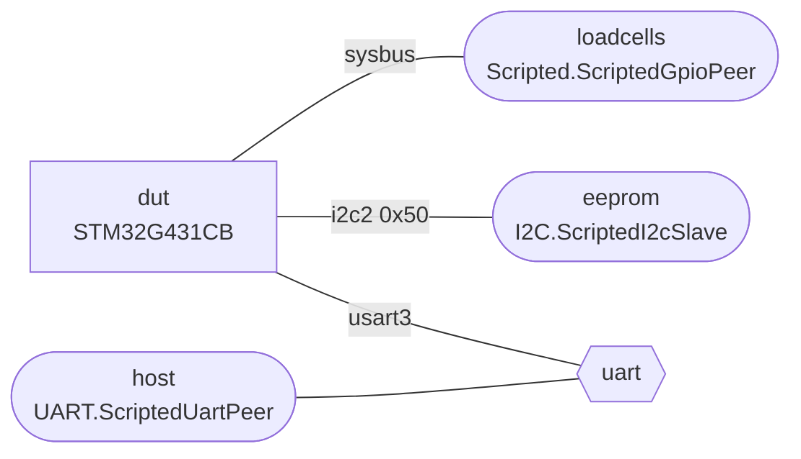
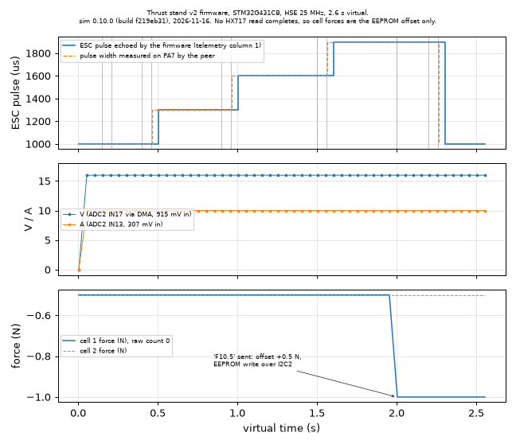

# Motor Test Stand

Motor test stand software and hardware designs

## Running the firmware in a simulator (`sim/`)

This fork adds `sim/`, which runs the **real `firmware/v2` image** (STM32G431CBUx, HAL, unmodified sources) in the
Simantic simulator with the board's other parts as small Python peers. Everything under `sim/` is
an addition of this fork; the upstream files, including the MIT `LICENSE`, are untouched. Numbers below are from
`sim 0.10.0 (build f219eb31)`, run 2026-11-16, 2.6 s of virtual time each (17 to 34 s of wall time).

What runs, and what is a stand-in:

| Part | In the sim | Status |
| --- | --- | --- |
| STM32G431CB, `firmware/v2` | the firmware as built by `sim/build.sh` (arm-none-eabi-gcc, no source change) | the model is flagged "incomplete" by `sim models`; it runs with a warning |
| ESC command over USART3 (PC10/PC11) | scripted PC peer (`peers/host.py`) sends `P1300`, `P1600`, `P1900`, `P1000` (each twice, as the firmware requires) and `F10.5` | works |
| ESC signal on PA7 (TIM17 CH1) | pulse width measured on the pad by `peers/loadcells.py` | works |
| V and I sense (ADC2 IN17, IN13, DMA) | fixed 915 mV and 307 mV on the pins | works; the inputs are constant (static `channelMillivolts`), so V and A do not follow throttle |
| Calibration EEPROM M24C01 on I2C2 (0x50) | `peers/m24c01.py`, preloaded with an invented calibration image | works: the 64-byte read at boot and the 8-byte write after `F10.5` both happen |
| 6 x HX717 load-cell amplifiers (PB0, PB1, PB2, PB11, PB12, PB13, clock PB10 from TIM2 CH3) | `peers/loadcells.py`, written to the HX717 protocol with an invented thrust model | **does not complete a read, see "Gaps"**: unverified beyond the ready flag |



(`sim graph --scenario sim/scenario.yaml`; the load-cell and ESC pin wires are in `sim/stand.board`.)

### Configurations tried

| # | Configuration | Result (sim 0.10.0 f219eb31, 2026-11-16) |
| --- | --- | --- |
| A | stock `firmware/v2`, HSE 25 MHz (the HAL's `HSE_VALUE`), `sh sim/run.sh` | 52 telemetry lines at 50.010 ms (TIM6 = 50 ms at the 150 MHz timer clock the PLL settings give from 25 MHz). Firmware echoes the pulse 1000, 1300, 1600, 1900. PA7 measures 1300, 1600, 1900 us for those commands. ADC reads 15.983 V and 10.010 A. After `F10.5` cell 1 reads -1.000 N (was -0.500) and 8 bytes are written to the EEPROM at 0x10. All run.sh assertions pass. |
| B | same ELF, HSE 24 MHz (what the sim assumes when a board declares no crystal), `HSE=24000000 sh sim/run.sh` | The PLL gives 144 MHz, so every timer derived from the 150 MHz assumption runs 4.17 % slow: telemetry period 52.094 ms, PA7 pulses 1354, 1666, 1979 us for the same 1300, 1600, 1900 commands, idle 1041 to 1044 us. The firmware code is correct for 25 MHz; this row shows what a wrong crystal declaration costs. Assertions that do not depend on the crystal pass. |
| C | A plus `sim/firmware-cnt-preset.patch` (clock counter preset 15 instead of 0xFFFF), `ELF=thrust-v2-patched.elf sh sim/run.sh` | Same as A for everything above. The load-cell clock still stops after two pulses (see Gaps). |

Not run: the first firmware (`firmware/v1`, USART2/ADC2/TIM15/16, no EEPROM), the C# Thrustlink application, any real stand.
The crystal on the real board was not checked: the HAL's `HSE_VALUE` is 25 MHz and `hardware/v2/main.SchDoc` contains the string `25MHz` (which part it labels was not checked); `sim/stand.board` declares 25 MHz.

### Screenshots

Both figures are drawn by `sim/plot.py` from the captures of `sim/run.sh`; nothing is mocked.



Configuration A, 2.6 s virtual, sim 0.10.0 (build f219eb31). Top: ESC pulse as the firmware echoes it in its telemetry and as measured on PA7 (vertical lines: the commands the PC peer sent). Middle: V and A from ADC2. Bottom: cell forces; cell 1 steps by -0.5 N when `F10.5` raises its offset. The forces are only the EEPROM offset because no HX717 read completes.


Configurations A and B, 2.6 s virtual each, sim 0.10.0 (build f219eb31): measured PA7 pulse width and telemetry period for the two crystal declarations.

### Gaps (found, not worked around)

* **HX717 clock never completes a read.** TIM2 is a down-counting PWM (PSC 149, ARR 15, CCR3 10) started with `HAL_TIM_PWM_Start_IT`. In config A the first CC3 interrupt fires about 1 us after the start (consistent with CC3IF left set by the init-time PWM run; not checked on silicon) and then no further PD_SCK edge or CC3 callback occurs for the rest of the run, so the firmware never reaches 25 pulses and `RawCellReadings` stays 0. In config C two callbacks occur and then the clock stops. Repro: `sim run --scenario sim/out/25000000-thrust-v2/scenario.yaml --timeout 0.4 --trace-symbol HAL_TIM_PWM_PulseFinishedCallback` after `sh sim/run.sh`. Not checked against silicon: whether the firmware's `CNT = 0xFFFF` preset in a down-counting timer behaves as the author intended on a real part. No model change was made here.
* ADC inputs are constant; a current sensor that follows thrust needs a dynamic source.
* The thrust model in `peers/loadcells.py` and the calibration image in `peers/m24c01.py` are invented (marked `MODELED SIMPLIFICATION`); no value is from a real stand.

### Run it

```sh
sh sim/build.sh              # firmware/v2 -> sim/build/thrust-v2.elf (needs arm-none-eabi-gcc)
sh sim/build.sh patched      # optional: configuration C's ELF
sh sim/run.sh                # configuration A, asserts on the UART output and peer reports
HSE=24000000 sh sim/run.sh   # configuration B
python3 sim/plot.py "build string"   # screenshots, needs matplotlib
```

`sim` is the Simantic simulator CLI. `sim/peers/` holds the peers (`host.py`, `loadcells.py`, `m24c01.py`).

### Changes to the firmware

None for configurations A and B: `firmware/v2` is built as committed, only the build is driven by `sim/build.sh`
instead of STM32CubeIDE (float printf/scanf are linked because the code formats and parses floats).
Configuration C applies `sim/firmware-cnt-preset.patch` to a scratch copy under `sim/build/`: two lines,
`__HAL_TIM_SET_COUNTER(&CELLAMP_CLK_HTIM, 0xffff)` becomes `15`. It exists only to test the gap above and is not part of the default run.

### Licence

Upstream is MIT (see `LICENSE`). The files under `sim/` are additions of this fork, offered under the same licence.
